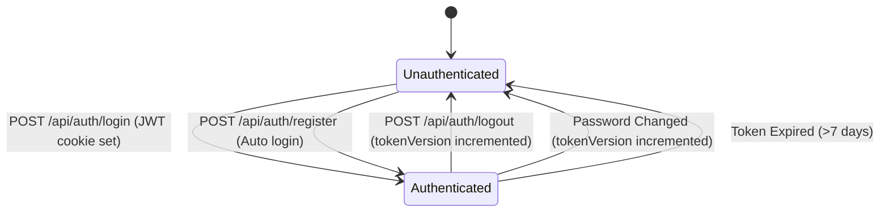
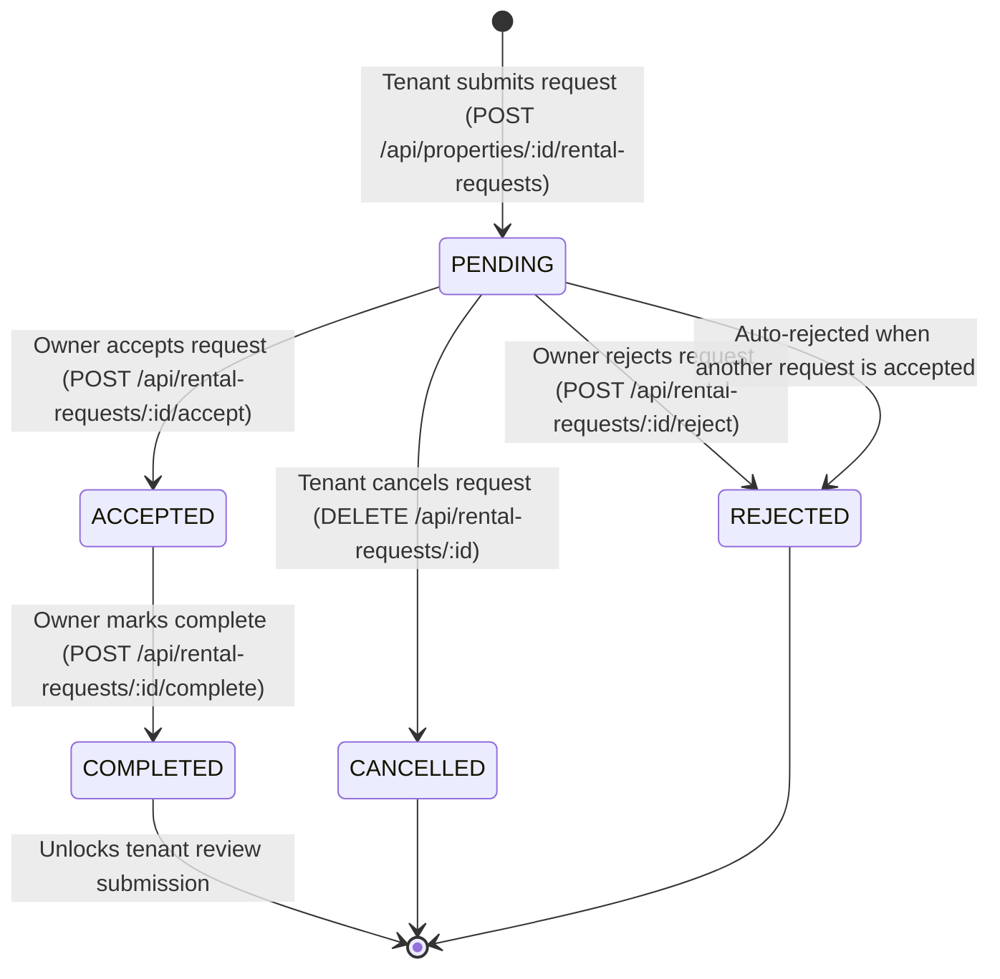

# Feature Architecture & Deep-Dive Specification — RentGoer

**Audit Date:** October 20, 2026  
**Auditor:** Senior Technical Documentation Auditor & Repository Verification Engineer  
**Scope:** Complete feature inventory, state machines, business logic, authorization rules, and edge-case handling across Tenant, Owner, and Admin workflows.

---

## 1. Feature Summary & Implementation Maturity

| Feature Domain | Primary Route(s) | Backend Controller | Status | Maturity Score | Confidence |
|---|---|---|---|---|---|
| **Auth & Sessions** | `/login`, `/register`, `/profile` | `auth.controller.ts` | Complete | 9.5 / 10 | **[Verified in source]** |
| **Property Management** | `/properties`, `/owner/properties/*` | `property.controller.ts` | Complete | 9.0 / 10 | **[Verified in source]** |
| **Image Pipeline** | Modal / Multipart Upload | `property-image.controller.ts` | Complete | 8.5 / 10 | **[Verified in source]** |
| **Search & Filtering** | `/properties` | `property.controller.ts` | Complete | 9.0 / 10 | **[Verified in source]** |
| **Favorites System** | `/favorites`, Card Heart icon | `favorite.controller.ts` | Complete | 9.5 / 10 | **[Verified in source]** |
| **Rental Requests** | `/rental-requests`, `/owner/requests` | `rental-request.controller.ts` | Complete | 9.5 / 10 | **[Verified in source]** |
| **Direct Chat / Messaging** | `/chat`, `/chat/[id]` | `chat.controller.ts` | Complete | 9.0 / 10 | **[Verified in source]** |
| **Real-time Notifications** | In-app bell, `/notifications` | `notification.controller.ts` | Complete | 8.5 / 10 | **[Verified in source]** |
| **Reviews & Ratings** | `/properties/[id]` | `review.controller.ts` | Complete | 9.0 / 10 | **[Verified in source]** |
| **Reports & Moderation** | Modal / `/reports`, `/admin/reports` | `report.controller.ts` | Complete | 8.5 / 10 | **[Verified in source]** |
| **User/Property Verification** | `/owner`, `/admin/verification` | `verification.controller.ts`, `admin-verification.controller.ts` | Complete | 9.0 / 10 | **[Verified in source]** |
| **Admin Operations** | `/admin/*` | `admin-*.controller.ts` (5 controllers) | Complete | 8.5 / 10 | **[Verified in source]** |

---

## 2. Deep-Dive by Functional Domain

### 2.1 User Authentication & Session Security

#### Core Capabilities
- **Registration (`POST /api/auth/register`):**
  - Accepts `name`, `email`, `password`, `role` (`TENANT` or `OWNER`) **[Verified in source]**.
  - Strict guard: registration with role `ADMIN` returns HTTP 403 (`"Cannot register as ADMIN"`) **[Verified in source]**.
  - Passwords hashed with `bcrypt.hash(password, 12)` (cost factor 12) **[Verified in source]**.
  - Checks case-insensitive email uniqueness via normalized lowercase string **[Verified in source]**.
- **Login (`POST /api/auth/login`):**
  - Validates credentials using `bcrypt.compare` **[Verified in source]**.
  - Generates a signed JWT with claims: `{ id, role, tokenVersion }` **[Verified in source]**.
  - Sets an `HttpOnly`, `SameSite=Lax`, `Secure` (in production) cookie named `rentgoer_token` with 7-day TTL (`maxAge: 7 * 24 * 60 * 60 * 1000`) **[Verified in source]**.
- **Session Revocation & Logout (`POST /api/auth/logout`):**
  - Increments `user.tokenVersion` in PostgreSQL, immediately invalidating all active JWTs on all devices **[Verified in source]**.
  - Clears `rentgoer_token` cookie with matching options **[Verified in source]**.
- **Password Change (`PUT /api/auth/change-password`):**
  - Requires `currentPassword` verification before accepting `newPassword` (minimum 8 chars) **[Verified in source]**.
  - Atomically increments `tokenVersion` upon password change to terminate all other sessions **[Verified in source]**.
- **Email Change (`PUT /api/auth/change-email`):**
  - Requires password verification, validates email format and uniqueness, increments `tokenVersion`, and re-issues cookie **[Verified in source]**.

#### State Machine: User Authentication

---

### 2.2 Property Lifecycle & Media Management

#### Core Capabilities
- **Creation & Modification (`POST /api/properties`, `PUT /api/properties/:id`):**
  - Strict RBAC: Only `OWNER` role can create or update listings **[Verified in source]**.
  - Ownership assertion: Cannot update or delete a property unless `property.ownerId === req.user.id` **[Verified in source]**.
  - Database schema fields verified in `backend/prisma/schema.prisma`:
    - `title`: String
    - `description`: String
    - `rent`: Float
    - `securityDeposit`: Float
    - `city`: String
    - `locality`: String
    - `address`: String
    - `latitude`: Float? (optional)
    - `longitude`: Float? (optional)
    - `bedrooms`: Int
    - `bathrooms`: Int
    - `propertyType`: Enum (`APARTMENT`, `HOUSE`, `ROOM`, `PG`, `STUDIO`)
    - `furnishedStatus`: Enum (`FURNISHED`, `SEMI_FURNISHED`, `UNFURNISHED`)
    - `availableFrom`: DateTime
    - `isAvailable`: Boolean (default: true)
    - `isVerified`: Boolean (default: false)
    *(Note: The database does not contain `amenities`, `carpetArea`, `state`, or `pincode` columns)* **[Verified in source]**.
- **Availability Toggle:**
  - Owner can toggle availability via `PUT /api/properties/:id` (`isAvailable = true/false`) **[Verified in source]**.
  - Property is automatically marked `isAvailable = false` when an owner accepts a rental request **[Verified in source]**.
- **Media Upload Pipeline (`POST /api/properties/:id/images`):**
  - Managed by `property-image.controller.ts` with `multer` in-memory buffering **[Verified in source]**.
  - Validates MIME types (`image/jpeg`, `image/png`, `image/webp`) **[Verified in source]**.
  - Limits file size to 5MB per image, maximum 5 images per upload request **[Verified in source]**.
  - Enforces a hard ceiling of **10 images maximum per property** in the `PropertyImage` table **[Verified in source]**.
  - Uploads to Supabase Storage bucket `property-images` with structured path: `properties/{propertyId}/{uuid}.{ext}` **[Verified in source]**.
  - Stores `{ propertyId, url: publicUrl, publicId: storagePath }` records in PostgreSQL **[Verified in source]**.
  - If any image in a batch fails, already-uploaded storage files are rolled back via `supabase.storage.from(...).remove(...)` **[Verified in source]**.
  - Deletion via `DELETE /api/properties/:id/images/:imageId` deletes both storage object and DB record **[Verified in source]**.

---

### 2.3 Search, Filtering & Discovery Engine

#### Query Pipeline (`GET /api/properties`)
Implemented in `backend/src/controllers/property.controller.ts` **[Verified in source]**:
1. **Full-Text Match:** Case-insensitive search on `title`, `description`, `address`, `locality`, and `city` using Prisma `contains` with `mode: 'insensitive'` **[Verified in source]**.
2. **Faceted Filtering:**
   - Price range: `rent >= minRent` and `rent <= maxRent` **[Verified in source]**.
   - Dimensions: exact match on `bedrooms` and `bathrooms` **[Verified in source]**.
   - Categorical: `propertyType` matching, `furnishedStatus` matching **[Verified in source]**.
   - Location: `city` and `locality` case-insensitive substring matching **[Verified in source]**.
   - Availability constraint: defaults to `isAvailable: true` unless explicitly requested otherwise **[Verified in source]**.
   - Verification filter: `isVerified = true` **[Verified in source]**.
3. **Sorting:**
   - `rent_asc` / `rent_desc`
   - `newest` (`createdAt: 'desc'`) — default
   - `verified` (`isVerified: 'desc'`, `createdAt: 'desc'`) **[Verified in source]**.
4. **Pagination:**
   - Offset pagination (`page`, `limit`). Default limit: 12 properties per page; maximum: 50 **[Verified in source]**.
   - Returns `{ properties, total, totalPages, currentPage, hasNextPage }` **[Verified in source]**.
5. **Rating Aggregations:**
   - Executes parallel Prisma `groupBy` on `Review` table to calculate average rating and review count per property in a single batch query, avoiding N+1 queries **[Verified in source]**.

---

### 2.4 Favorites System

#### Core Capabilities
- **Add to Favorites (`POST /api/properties/:id/favorite`):**
  - Protected route for `TENANT` role only **[Verified in source]**.
  - Creates a `Favorite` record linking `userId` and `propertyId` **[Verified in source]**.
- **Remove from Favorites (`DELETE /api/properties/:id/favorite`):**
  - Protected route for `TENANT` role only **[Verified in source]**.
  - Deletes the `Favorite` record for the property **[Verified in source]**.
- **Compound Unique Constraint:**
  - Compound unique constraint on `[userId, propertyId]` in Prisma prevents duplicate favorites **[Verified in source]**.
- **List Favorites (`GET /api/favorites`):**
  - Returns paginated list of favorited properties with images, owner info, and aggregated ratings **[Verified in source]**.
- **List Favorited IDs (`GET /api/favorites/ids`):**
  - Lightweight endpoint returning a simple array of string IDs (`string[]`) **[Verified in source]**.
- **Frontend Architecture (`FavoritesContext.tsx`):**
  - On mount, tenants fetch `/favorites/ids` to populate `favoriteIds: string[]` **[Verified in source]**.
  - Exposes `toggleFavorite(propertyId)`: performs optimistic update on `favoriteIds`, then calls `DELETE /properties/:id/favorite` if already favorited, or `POST /properties/:id/favorite` if not **[Verified in source]**.
  - Reverts local state if the network request fails **[Verified in source]**.
  - Exposes `favoriteCount: number` (derived from `favoriteIds.length`) which drives the Navbar Heart badge **[Verified in source]**.

---

### 2.5 Rental Request Lifecycle & Concurrency Control

#### State Transition Machine

#### Concurrency & ACID Guarantees (`rental-request.controller.ts`)
1. **Interactive Transaction (`prisma.$transaction`):**
   - When owner accepts a request (`POST /api/rental-requests/:id/accept`):
     - Validates property ownership and asserts request is currently `PENDING` **[Verified in source]**.
     - Atomically locks parent `Property` row by updating `isAvailable: true` -> `false` first (consistent lock ordering prevents deadlocks) **[Verified in source]**.
     - Transitions target request status to `ACCEPTED` **[Verified in source]**.
     - Atomically transitions **all other PENDING requests** for that property to `REJECTED` **[Verified in source]**.
     - Links an existing conversation or creates a new `Conversation` between tenant and owner **[Verified in source]**.
     - Dispatches real-time SSE notifications to the accepted tenant and all auto-rejected tenants **[Verified in source]**.
2. **Deadlock & Retry Handling:**
   - Wrapped in a retry loop (up to 3 attempts) handling Prisma conflict codes `P2002`, `P2034`, and PostgreSQL 40P01 deadlock errors **[Verified in source]**.
3. **Single Rejection Caveat:**
   - When an owner individually rejects a request via `POST /api/rental-requests/:id/reject`, the status transitions to `REJECTED`, but no in-app notification is emitted to the tenant **[Verified in source]**.

---

### 2.6 Messaging & Real-Time Chat

#### Capabilities
- **Pre-Rental & Post-Acceptance Conversations (`POST /api/conversations` or `/pre-rental`):**
  - Tenants can initiate a conversation with an owner before applying (pre-rental inquiry) or post-acceptance **[Verified in source]**.
  - Compound unique constraint `@@unique([propertyId, tenantId])` enforces 1-on-1 conversation idempotency **[Verified in source]**.
  - Prevents self-chat (`ownerId !== tenantId`) **[Verified in source]**.
- **Direct Messaging (`POST /api/conversations/:id/messages`):**
  - Validates sender is an authorized participant (tenant or owner) **[Verified in source]**.
  - Persists message in PostgreSQL (`content: String`, `senderId: String`, `conversationId: String`) **[Verified in source]**.
  - Updates `conversation.updatedAt` timestamp **[Verified in source]**.
  - Broadcasts message via `chatEventEmitter.emit('message:${conversationId}', message)` **[Verified in source]**.
  - Emits in-app notification of type `CHAT_MESSAGE` to the recipient **[Verified in source]**.
- **Real-Time Delivery & Fallback:**
  - Client connects via SSE: `GET /api/conversations/:id/realtime` **[Verified in source]**.
  - Server sends keepalive ping every 20 seconds (`: ping\n\n`) and sets `X-Accel-Buffering: no` **[Verified in source]**.
  - Client hook `useConversationRealtime` listens for incoming messages. If SSE disconnects (`onerror`), it starts a **5-second polling fallback** (`/conversations/:id/messages?after=...`) until reconnection **[Verified in source]**.
- **Read Receipt & Synchronization:**
  - Client marks conversation as read via `PATCH /api/conversations/:id/read` (or `POST`) **[Verified in source]**.
  - Atomically marks unread messages as read (`readAt = now`) and marks corresponding `CHAT_MESSAGE` notifications as read (`isRead = true`, `readAt = now`) **[Verified in source]**.
  - Emits `NOTIFICATION_READ_SYNC` event carrying updated `unreadNotificationCount` and `unreadChatCount` to keep all open tabs and UI badges synchronized **[Verified in source]**.

---

### 2.7 In-App Notifications & SSE Stream

#### Delivery Architecture
- **SSE Channel (`GET /api/notifications/realtime`):**
  - Handled by `notification.controller.ts` using `notificationEventEmitter` **[Verified in source]**.
  - Keeps connection open with `text/event-stream`, `Cache-Control: no-cache` **[Verified in source]**.
  - Tracked by `sseTracker.addNotificationConnection(userId)` (capped at 3 per user) **[Verified in source]**.
  - Closes on client disconnect, removing listener and tracker count **[Verified in source]**.
- **Notification Types (Prisma Enum `NotificationType`):**
  - `RENTAL_REQUEST` (alert owner of new rental request) **[Verified in source]**.
  - `REQUEST_ACCEPTED` (alert tenant of accepted request) **[Verified in source]**.
  - `REQUEST_REJECTED` (alert tenant when auto-rejected on competing accept) **[Verified in source]**.
  - `CHAT_MESSAGE` (alert recipient of new chat message) **[Verified in source]**.
- **Read Synchronization (`NOTIFICATION_READ_SYNC`):**
  - Emitted when conversations or notifications are marked as read **[Verified in source]**.
  - Carries authoritative server counters: `unreadNotificationCount` and `unreadChatCount` **[Verified in source]**.
  - Client `NotificationContext` updates state and dispatches DOM event `chat:unread_sync` **[Verified in source]**.

---

### 2.8 Reviews & Trust Architecture

#### Business Logic Constraints
- **Eligibility Barrier (`POST /api/properties/:id/reviews`):**
  - Tenant must have a rental request with status `COMPLETED` for that property **[Verified in source]**.
  - Unique constraint `@@unique([rentalRequestId])`: exactly 1 review per completed rental request **[Verified in source]**.
  - Owners cannot review their own properties **[Verified in source]**.
- **Rating Parameters:**
  - `rating`: Integer between 1 and 5 **[Verified in source]**.
  - `comment`: String (minimum 10 chars, maximum 1000 chars) **[Verified in source]**.
  - `title`: Optional string **[Verified in source]**.
- **Modifications:**
  - Tenant can edit review via `PUT /api/reviews/:id` or delete via `DELETE /api/reviews/:id` **[Verified in source]**.

---

### 2.9 Reporting & Platform Moderation

#### Workflow
- **Submission:**
  - Generic: `POST /api/reports` with `{ targetType, targetId, reason, description }` **[Verified in source]**.
  - Shortcuts: `POST /api/properties/:id/report`, `POST /api/users/:id/report`, `POST /api/messages/:id/report` **[Verified in source]**.
  - Target types: `PROPERTY`, `USER`, or `MESSAGE` **[Verified in source]**.
  - Reasons (9 enum values): `FRAUD`, `SCAM`, `FAKE_LISTING`, `INAPPROPRIATE_CONTENT`, `HARASSMENT`, `SPAM`, `MISLEADING_INFORMATION`, `SAFETY_CONCERN`, `OTHER` **[Verified in source]**.
- **Admin Processing (`/admin/reports`):**
  - List reports: `GET /api/admin/reports` with filters for status, targetType, reason **[Verified in source]**.
  - View detail: `GET /api/admin/reports/:id` **[Verified in source]**.
  - Update status: `PUT /api/admin/reports/:id/status` (`status`: `OPEN` | `REVIEWING` | `RESOLVED` | `DISMISSED`, `moderatorNote`) **[Verified in source]**.

---

### 2.10 Verification Badging System

#### Workflow
- **Owner Verification:**
  - Owner submits verification request: `POST /api/verification/owner` **[Verified in source]**.
  - Stored in `VerificationRequest` with `type: 'OWNER'`, `status: 'PENDING'` **[Verified in source]**.
  - Admin approves via `PUT /api/admin/verification/:id/approve` or rejects via `PUT /api/admin/verification/:id/reject` (`rejectionReason`) **[Verified in source]**.
  - On approval, `user.isVerified = true`; "Verified Owner" badge displayed **[Verified in source]**.
- **Property Verification:**
  - Owner submits property verification: `POST /api/properties/:id/verification` **[Verified in source]**.
  - Stored in `VerificationRequest` with `type: 'PROPERTY'`, `propertyId: id` **[Verified in source]**.
  - On approval, `property.isVerified = true`; "Verified Property" badge displayed **[Verified in source]**.

---

### 2.11 Admin Dashboard & Operations

#### Surface Areas
- `/admin` — Metrics overview via `GET /api/admin/stats`: total tenants, total owners, total active properties, open reports, pending verifications **[Verified in source]**.
- `/admin/users` — User management via `GET /api/admin/users` and `/admin/users/:id` **[Verified in source]**.
- `/admin/properties` — Listing oversight via `GET /api/admin/properties` and `/admin/properties/:id` **[Verified in source]**.
- `/admin/verification` — Verification queue via `GET /api/admin/verification` **[Verified in source]**.
- `/admin/reports` — Incident queue via `GET /api/admin/reports` **[Verified in source]**.
